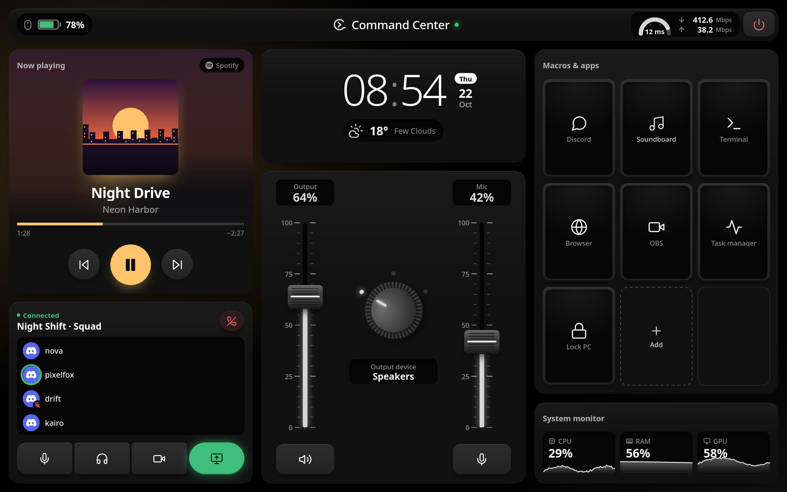
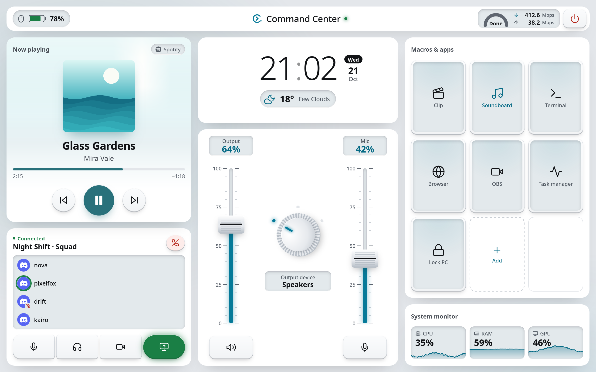

# Touch Dashboard

A touch control surface for your PC: an Android tablet (or any browser) becomes a desk console with studio faders, a now-playing deck, Discord voice controls, macro keys and a live system monitor. An open alternative to Stream Deck and Touch Portal, for Linux and Windows.

## Heads Up

This project is a tablet-oriented macro pad and system dashboard, intended as an alternative to tools like Stream Deck or Touch Portal.

The code itself is mostly AI-generated, but the logic is human-reviewed. It currently exists mainly to fit my own workflow and hardware setup. I do plan to make it more modular and generally useful over time, and contributions are welcome from anyone who wants to improve it.





<p align="center"><sub>Graphite (the default) and Daylight, two of six themes. Rendered from the app with demo content; the play key and the light around the panels take their colour from the cover that is playing.</sub></p>

---

## Contents

- [What it does](#what-it-does)
- [How it works](#how-it-works)
- [Install](#install)
- [First-time setup](#first-time-setup)
- [Using the dashboard](#using-the-dashboard)
- [Updating](#updating)
- [Security](#security)
- [Troubleshooting](#troubleshooting)
- [Platform notes](#platform-notes)
- [For developers](#for-developers)

## What it does

| Module | What you get |
|---|---|
| **Now playing** | Cover art, title, artist, playing app and track progress, with previous / play-pause / next; long titles scroll. Works with Spotify (Web API) or any local player: MPRIS via `playerctl` on Linux, the system media controls on Windows. The cover's colour tints the play key, the progress bar and the light around the panels. |
| **Audio mixer** | Two studio faders for speaker and microphone volume, each with a mute key, and a rotary encoder that switches the output device (one LED per device; hide the ones you never use). |
| **Discord** | Mute, deafen, camera and screen share, the current voice channel, who is in it and who is speaking, and a leave-call key. |
| **Macros & apps** | Nine display keys: launch apps, send keyboard shortcuts, open the soundboard or trigger clip recording. |
| **Soundboard** | Drum pads that play clips into your microphone (Linux, through PipeWire) or through Soundpad / a local folder (Windows). |
| **System** | CPU, RAM and GPU load with a live trace of the last minute, mouse battery, a network speed test and a power-off key. |
| **Clock & weather** | Time, date and current weather from OpenWeatherMap. |
| **Lock screen** | When the PC locks, the tablet shows a large clock with the weather; it shifts slightly every minute to protect OLED screens. |
| **Themes** | Graphite, Daylight, Ember, Phosphor, Amethyst and Midnight. A choice applies to every connected screen. |

## How it works

Touch Dashboard is client and server:

- **The desktop app** runs on your PC. It reads audio, media, Discord, hardware and battery state, runs your macros, and serves the dashboard on port **8888** over HTTP and WebSocket. It opens a desktop window of the dashboard and lives in the system tray.
- **The Android app** is a full-screen WebView with the dashboard built in. It connects to the PC over your local network and installs its own updates.
- **Any browser** on the PC or the network can open the dashboard at `http://<pc-ip>:8888` as well.

The PC and the tablet must be on the same network. Every tablet, and every browser on another device, is paired once: the PC shows a request and you allow it. See [Security](#security).

## Install

### Windows

1. From the [latest release](https://github.com/Liburn-Bajraktari/Touch-Dashboard/releases/latest), download `install.ps1` and `SHA256SUMS` into the same folder.
2. Open PowerShell as administrator (so the installer can add the firewall rule), go to that folder and check the installer against the published checksum. It prints `True` when they match; if it prints `False`, delete the file and do not run it:
   ```powershell
   (Get-FileHash .\install.ps1 -Algorithm SHA256).Hash -eq ((Select-String -Path .\SHA256SUMS -Pattern ' install\.ps1$').Line -split '\s+')[0]
   ```
3. Run it:
   ```powershell
   powershell -ExecutionPolicy Bypass -File .\install.ps1
   ```
4. A text menu opens. Press **1** to download the app, set up Python and create the Start Menu and desktop shortcuts. The app installs to `%LOCALAPPDATA%\Touch-Dashboard`.
5. Launch **Touch Dashboard** from the Start Menu. It opens the dashboard window and keeps running in the system tray when you close the window (you can turn that off in the window's menu).

The installer also has a repair mode, an uninstaller, and an option (4) to download the latest Android APK to your PC. It installs the latest release, never unreleased code: it downloads that release's source archive and refuses it unless it matches the release's `SHA256SUMS`. Run as administrator, it opens port 8888 in Windows Firewall for private networks and your local subnet only; on a network Windows classes as Public the dashboard stays closed.

#### Advanced: quick install

To download and run the installer in one step, without the checksum check:

```powershell
irm https://raw.githubusercontent.com/Liburn-Bajraktari/Touch-Dashboard/main/scripts/install.ps1 | iex
```

This runs the installer as it is on the `main` branch at that moment, unchecked. It then installs the latest release the same way, checked against its `SHA256SUMS`.

### Linux

Run:

```bash
bash -c "$(curl -fsSL https://raw.githubusercontent.com/Liburn-Bajraktari/Touch-Dashboard/main/scripts/setup.sh)" < /dev/tty
```

The script detects Arch, Debian/Ubuntu or Fedora, installs the system packages it needs (Python, PipeWire and WirePlumber, `playerctl`, `webkit2gtk-4.1`, `python-dbus`, `python-gobject`, `upower`), installs the latest release to `~/.local/share/Touch-Dashboard` (its source archive is checked against the release's `SHA256SUMS` first) and adds **Touch Dashboard** to your application menu. On other distributions it lists the packages to install yourself.

### Android

1. Download the latest `TouchDashboard-vX.Y.Z.apk` from the [Releases](https://github.com/Liburn-Bajraktari/Touch-Dashboard/releases) page, or with option 4 of the Windows installer.
2. Copy it to your tablet or phone and install it. You may need to allow installing apps from unknown sources.

After that the app keeps itself up to date (see [Updating](#updating)).

**Coming from v0.11.0 or older?** Uninstall the old app first. The app is now signed with its own release key, so Android refuses to install it over one signed with the old key. Then install the new one and pair it again. This happens once.

## First-time setup

### 1. Start the desktop app and find your IP

Start **Touch Dashboard** on the PC. Its local IP address is shown in the tray icon's menu (right-click it) and in the desktop window's title bar, for example `192.168.1.50`.

### 2. Connect the tablet

1. Open the Touch Dashboard app on the tablet.
2. On first launch it asks for the PC's IP address. Enter it and tap **Connect**. Use the address itself: host names such as `mypc.local` are refused.
3. The tablet asks to pair. Check its name and tap **Request access**. It shows a six-digit code.
4. On the PC, the dashboard window comes forward with a **Pairing request** showing a code. If it is the same code, click **Allow**. The request expires after a minute.
5. The app remembers the PC and its pairing. The green light next to the title means the tablet is connected. To unpair it, tap the title and choose **Forget this PC**.

A browser on another device (`http://<pc-ip>:8888`) pairs the same way. The desktop window and a browser on the PC itself (`http://127.0.0.1:8888`) need no pairing.

### 3. Configure the integrations

Settings, macros and soundboard pads are edited on the PC only, and apply to every connected screen:

- **Desktop window:** open the menu button (top left) and choose **Settings**.
- **Browser on the PC:** go to `http://127.0.0.1:8888` and double-click anywhere outside a button.

Click **Save & apply** when you are done (themes apply as soon as you tap them).

| Tab | What to set |
|---|---|
| **General** | Show or hide the mouse battery and the system monitor; turn the Spotify, Weather, Discord, Audio routing and Soundboard modules on or off. |
| **Themes** | Pick one of six presets. Each card previews its theme. |
| **Spotify** | Create an app in the [Spotify developer dashboard](https://developer.spotify.com/dashboard), set its Redirect URI to exactly `http://127.0.0.1:8888/callback`, enter the Client ID and Secret, then click **Connect Spotify**. Do this first sign-in on the PC itself. Without Spotify, local players are still shown. |
| **Weather** | Enter a free [OpenWeatherMap](https://openweathermap.org/) API key and your city, spelled exactly as on its OpenWeather city page. |
| **Discord** | Create an application in the [Discord developer portal](https://discord.com/developers/applications), set its Redirect URI to exactly `http://127.0.0.1:8888/disc_callback`, enter the Client ID and Secret, then click **Authorize Discord**. Discord must be running on the PC. Optional: show the voice channel, sort active speakers to the top, and choose whether paired tablets may turn your camera and screen share on or off. |
| **Audio routing** | Give each output device a short name (up to 10 characters) for the output encoder's display, or hide it (the eye key) so the encoder skips it. |
| **Soundboard** | The absolute path of your sounds folder (`.mp3`, `.wav`, `.ogg`, `.flac`, `.m4a`), and optional volume normalisation to a target level (needs `ffmpeg`; 89 dB is the ReplayGain standard Soundpad uses). |
| **Paired devices** | The tablets and browsers you allowed, when each was paired and last seen. Rename one, or remove it: it is disconnected at once and has to be paired again. |

#### Using Vesktop instead of Discord

Vesktop has to have its local IPC server turned on:

1. In Vesktop open **Settings**, scroll to the **Vencord** section and click **Open Settings Folder**.
2. Open `settings.json` (or `settings/settings.json`) in a text editor and make sure both are `true`:
   ```json
   {
     "discordIpc": true,
     "arRPC": true
   }
   ```
3. Restart Vesktop.

If the Discord tab then shows **Vesktop detected**, its arRPC bridge cannot control voice: the voice channel still shows, but use the official Discord app or Vencord for mute and deafen.

## Using the dashboard

| To | Do this |
|---|---|
| Change volume | Drag a fader cap, or tap anywhere on its track to jump there. On Android tablets that allow it, you feel a tick every 10 %. |
| Mute | Tap the key under a fader, or pull the fader below 0. |
| Switch output device | Tap the encoder. The lit LED shows which device is active; devices hidden in **Audio routing** are skipped. |
| Control playback | Previous, play/pause and next under the cover. |
| Discord voice | Mute, deafen, camera and screen share keys; the red key next to the channel name leaves the call. |
| Run a macro | Tap its key. |
| Add or edit a macro | On the PC: tap **Add**, or press and hold a key for about half a second. A macro can launch an app, send a keyboard shortcut, run a pre-made action (terminal, browser, task manager) or a plugin (soundboard, clip recording). |
| Use the soundboard | Tap the **Soundboard** key. Tap a pad to play it; on the PC, press and hold to edit it; **Stop audio** stops playback. On Linux the bar at the top sets the soundboard volume and toggles hearing it yourself. |
| Run a speed test | Tap the gauge at the top right. |
| Turn off the PC | Tap the power key: it opens your desktop's shutdown prompt (KDE, GNOME, Xfce, Cinnamon, MATE or Windows). |
| Go full screen (browser) | Double-tap an empty area. |
| Unpair the tablet | Tap the title at the top, then **Forget this PC**. |

## Updating

- **Desktop app:** it checks for new releases on start and every 30 minutes, and shows an update prompt in the desktop window and in a browser on the PC. **Update** downloads that release's installer and source archive, checks both against the release's `SHA256SUMS`, installs it in the background and restarts the app. A file that does not match stops the update.
- **Android app:** it updates itself. When a newer app is released, the tablet offers **Update now** (or requires it, when the desktop app needs the newer version). The app downloads the APK from the GitHub release, checks it against the release's `SHA256SUMS` and checks that it is signed by the same key, then Android asks you to confirm. The first time, Android asks whether Touch Dashboard may install apps: turn on **Allow from this source** and come back. The app closes while Android installs it; open it again from the home screen.
- **Android apps from v0.11.0 and older** cannot update themselves. They show how to install the new app by hand: download it in Chrome, uninstall the old app, install the new one and pair again. Apps from before pairing (older than v0.11.0) cannot connect any more and only show this prompt.

## Security

- **Local network only.** Touch Dashboard is built for your home network. Do not port-forward port 8888 or expose it to the internet in any other way.
- **Every device is paired and approved on the PC.** A tablet or a browser on another device sends a pairing request and shows a six-digit code; the PC shows the same code and asks you to allow or deny it. Requests expire after a minute, and the PC takes at most one at a time per device and five a minute. Only the desktop window and a browser on the PC itself connect without pairing. **Settings → Paired devices** lists every device; removing one cuts it off at once.
- **Paired devices control, the PC configures.** A paired device can use media, volume, Discord, the soundboard and your macros, by name only. Settings, macros, soundboard pads, pairing and updates can only be changed on the PC. API keys, client secrets and sign-in tokens never leave the PC.
- **Traffic is not encrypted.** The dashboard uses plain HTTP and WebSocket, so anyone on the same network can read it, including a device's pairing token. Avoid shared and public networks (cafés, hotels, campus or office Wi-Fi).
- **Web pages cannot reach it.** The server answers only to `127.0.0.1`, `localhost` and this PC's own addresses, and only to its own pages and the Android app. A website you visit cannot talk to it, even through DNS rebinding, and cannot finish a Spotify or Discord sign-in on your PC (each sign-in carries a one-time state value).
- **Updates install releases only.** Installers and the in-app update fetch a published release, never the latest code on `main`, and check every file against the `SHA256SUMS` published with it. Drafts and pre-releases are never offered. The Android app downloads only from this repository's releases (the PC can name a version, not an address) and installs only an APK signed with its own release key; Android enforces the same key on every update.

## Troubleshooting

- **The tablet cannot connect:** check that both are on the same network, that the IP is the one from the tray menu, and that your firewall allows incoming connections on port 8888. Connect by IP address: host names are refused. On Windows, the firewall rule only covers networks marked **Private**: if Windows set up your home network as Public, change it in **Settings → Network & internet**.
- **The tablet asks to pair again:** it was removed in **Settings → Paired devices**, or it forgot the PC. Pair it again and allow it on the PC within a minute. `server.log` records every refused connection and why.
- **Spotify or Discord will not sign in:** the Redirect URI in their developer portal must match exactly (`http://127.0.0.1:8888/callback`, `http://127.0.0.1:8888/disc_callback`), and the sign-in must happen on the PC.
- **Logs:** `~/.config/touch-dashboard/server.log` on Linux, `%APPDATA%\touch-dashboard\server.log` on Windows. A crash also writes `crash_<time>.txt` next to it, with an error code to quote when reporting it.
- **Settings and data** live in the same folder (`config.json`, the Spotify token cache, sounds).

## Platform notes

- **Linux audio** uses PipeWire and WirePlumber (`wpctl`, `pactl`, `pw-play`, `pw-link`). The soundboard creates a virtual sink called `Dashboard-Soundboard`, plays clips into it and links it into the apps that use your microphone (Discord, OBS and so on). Routing like this depends on your setup and may need adjusting.
- **Mouse battery** on Linux comes from UPower over D-Bus, event-driven, for any mouse UPower knows about (`upower` must be installed). On Windows it reads `%TEMP%\g502_battery.txt`, written by an external script.
- **Windows** integrates with WASAPI (`pycaw`), COM for switching the default device, and WinRT for the media controls.
- **App launchers** follow your desktop environment and the `$TERMINAL` / `$BROWSER` variables instead of fixed program names.
- **The Android app** is a small native app (`android/`, plain Java) around a WebView with the dashboard bundled in. A change to the dashboard reaches tablets with the next APK release, which the app installs itself. It asks for `REQUEST_INSTALL_PACKAGES` (its own updates) and `VIBRATE` (haptic ticks), and keeps its pairing out of cloud backups.

## For developers

### Run from source

```bash
git clone https://github.com/Liburn-Bajraktari/Touch-Dashboard.git
cd Touch-Dashboard
python3 -m venv .venv
source .venv/bin/activate
pip install -r requirements.txt
```

On Linux, also install the PipeWire tools (`wpctl`, `pactl`, `pw-play`, `pw-link`), `playerctl` and `webkit2gtk-4.1`.

```bash
python server.py                 # desktop window + tray
python server.py --server-only   # headless server
python server.py --reload        # restart on file changes
python server.py --port 9999     # another port (the Android app always uses 8888)
```

Arch users can build and install a local pacman package with `./scripts/build-arch-package.sh -si`.

### Tests

```bash
python -m pytest tests -v
```

The suite covers the HTTP and WebSocket API, Host and Origin checks, pairing, roles and command hardening (`tests/test_security.py`), the volume worker and output switching (`tests/test_audio.py`), media parsing, and every theme preset's completeness, contrast and colour balance. The tests start the real server lifespan, which on Linux calls `pactl`. To keep a run off your live audio session, point `HOME` at a scratch folder and put stub `pactl`, `wpctl`, `pw-*` and `playerctl` scripts that exit 1 first on your `PATH`.

### Project layout

| Path | What it is |
|---|---|
| `server.py` | FastAPI app: WebSocket hub, HTTP routes, background polling, startup |
| `desktop.py` | Desktop window (pywebview) and tray icon (pystray) |
| `security.py` | Who may connect: paired devices, pairing requests and their limits, the Host and Origin allowlists |
| `audio_system.py`, `media.py`, `discord_ipc.py`, `macro_system.py`, `mouse_battery.py`, `lock_monitor.py` | Platform integrations |
| `templates/index.html` | The whole dashboard: markup, styles and script |
| `static/themes.js` | Every design token and the six theme presets |
| `docs/DESIGN.md` | The design system: light model, materials, components, motion and how to add a theme |
| `scripts/` | Installers (`setup.sh`, `install.ps1`), `release.sh`, `build-arch-package.sh` |
| `android/` | The Android app: manifest, resources and Java sources (WebView shell and self-updater) |
| `tests/` | The test suite |

### Releasing

```bash
./scripts/release.sh v1.2.3          # desktop release
./scripts/release.sh v1.2.3 --apk    # also rebuild the Android app
```

The script sets the version in `version.json`, commits everything in the working tree as `Release: <tag>`, tags and pushes, and creates the GitHub release with `install.ps1`, `setup.sh`, the source archives the installers download (`touch-dashboard-<tag>.tar.gz` and `.zip`, built from the tag with `git archive`), the APK (with `--apk`) and a `SHA256SUMS` file covering them all. Installers and the in-app update refuse a release without these files. The release is also mirrored to Codeberg, only so installs from before the move to GitHub keep finding updates. With `--apk` it first builds the Android app from `android/` with `scripts/build-android.sh` (the current `templates/` and `static/` bundled in, the version code taken from the tag, signed with the release key), so a failed build stops the release before anything is committed; it then uploads the APK and raises the required Android app version. Building needs the Android SDK and the release key: see [docs/android-signing.md](docs/android-signing.md).

### References

- [docs/DESIGN.md](docs/DESIGN.md): design rules and tokens.
- [docs/discord_documentation_links.md](docs/discord_documentation_links.md): Discord RPC and IPC documentation used by `discord_ipc.py`.
- Contributions are welcome. Read `docs/DESIGN.md` before changing the interface; `tests/test_themes.py` fails on hard-coded colours.
