# The World of Warcraft page

A page of the dashboard for playing WoW: your raid's note and its alerts as they come, pull and break timers, the ready check and who is not ready, your Mythic+ key against its chests, world markers, your buffs before the pull, gold, bags and keystones on every character, and keys for any command, the game's or an addon's. It talks to the game through the PC, with a small companion addon in WoW.

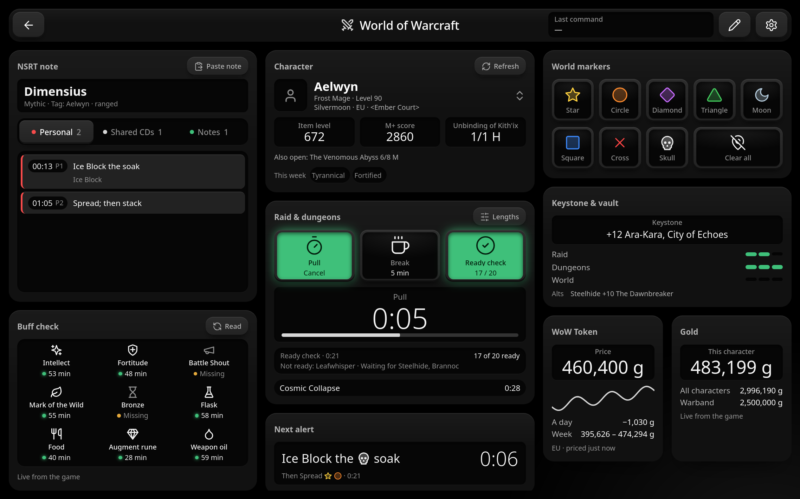

<p align="center"><sub>Every picture on this page is rendered from the app with fictional data (<code>scripts/wow_demo.py</code>), at the tablet's size. Names, numbers and times are made up.</sub></p>

**Contents:** [Getting started](#getting-started) · [How a key reaches the game](#how-a-key-reaches-the-game) · [The companion addon](#the-companion-addon) · [The plates](#the-plates) · [Arranging the page](#arranging-the-page) · [Settings](#settings) · [What it cannot do](#what-it-cannot-do) · [Making these pictures](#making-these-pictures)

---

## Getting started

1. **Add the page's key to the dashboard.** On the PC, add a key (or hold one to edit it), choose **Plugin → World of Warcraft**. Tapping it opens the page; the arrow at the top left goes back.
2. **Tell it where the game is.** On the PC, open the page's settings (the gear) → **General** → the game folder (the one with `_retail_` in it; `_retail_` itself, or a `SavedVariables` folder under it, works too, and `~` stands for your home folder). Nothing is assumed about where WoW is installed.
3. **Install the companion addon.** Same place: **Install**. It copies the addon into the game's `Interface/AddOns`. In WoW, `/reload` (or log in) and check it is on in the AddOns list. `/tdc` in game says it is running.
4. **Optionally, Battle.net.** Main settings → **Battle.net**: sign in for your characters, or add a client key for the character plate, spell names and the WoW Token's price. Raider.IO needs nothing.

The page works without the addon too, with less: keys are typed into chat, and the live plates (buffs, timers, alerts, Mythic+) stay empty.

---

## How a key reaches the game

WoW lets no addon talk to anything outside the game, so the PC presses keys, as you would. WoW must be the window in front: if it is not, nothing is pressed and the key shows ⚠. Your clipboard is put back every time.

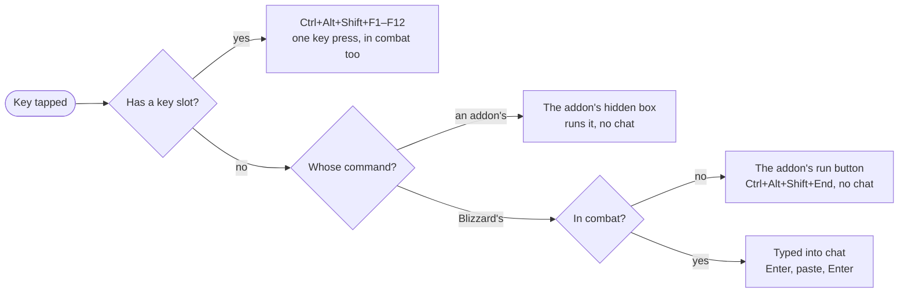

- **Key slots.** In settings → **Key slots**, give a command one of twelve slots. The addon holds its text in a hidden button bound to Ctrl+Alt+Shift+F1–F12, so the key is one key press: instant, and it works in combat and in chat lockdown.
- **The hidden box.** Ctrl+Alt+Shift+Home puts the keyboard in the addon's invisible input box; the PC pastes the command and presses Enter, and the addon runs it. For an addon's command (BigWigs, NSRT, Details!…) nothing shows in game.
- **The run button.** Blizzard's own commands (`/readycheck`, `/wm`, `/cast`…) an addon may not run. Out of combat the box loads them into a hidden button instead and the PC presses Ctrl+Alt+Shift+End: a real key press, so even protected commands run, and chat never opens. In combat WoW does not let the addon change that button, so these commands are typed into chat (a key slot avoids that).
- **Never blind.** While its box has the keyboard, the addon lights a small beacon on the top edge of the window; the PC reads the window and presses Ctrl+C, Ctrl+V or Enter only while it shows. Without the box those keys would reach your own bindings (Bloodlust on Ctrl+C, say).

Every macro is limited to 255 characters, as WoW's own are.

---

## The companion addon

The **Touch Dashboard** addon (`addon/TouchDashboard`) is what lets the page run commands without chat and see the game. It never runs anything on its own, and no key is ever pressed because of what it shows.

**The live link.** The addon draws a one-pixel line of coloured dots along the top edge of the game window, from a fifth of the way across to four fifths (the corners are where overlays such as Steam's FPS counter draw). The PC reads that line from the game's window ten times a second, so the page follows the game as it changes, with no keys pressed and in combat too. It carries your character, gold, bags, durability, weapon oil, keystone and group; your buffs of ten minutes or more and your consumables; boss mod bars and the pull countdown; the last ready check's answers; NSRT's alerts for the phase; and your Mythic+ run. Only what the game lets addons see: in combat, encounters and Mythic+ the game hides buffs from addons, and the addon leaves them out; in a dungeon or raid it also hides who started a pull countdown or a ready check and how long it runs. The line works on Linux (WoW through Wine or Proton under X11 or XWayland); elsewhere the page reads the game when a command goes through the box, or with the buff check's **Read** key.

**In game:**

| Command | What it does |
| :--- | :--- |
| `/tdc` | Says the addon's version, its key slots and whether the live link is on |
| `/tdc link off` / `/tdc link on` | Hides or shows the live link's line (the page then reads the game only through the box) |
| `/tdc nstest` | Runs NSRT's own test of phase 1's alerts; the alert plates follow it |

**Updates.** Once installed, the dashboard keeps the addon up to date in the game folder: a dashboard update brings a newer addon, and the PC copies it in. WoW loads it at the next `/reload` or login, and until then the addon tells you in chat, once, the next time the page uses it. When a newer addon is out with a newer dashboard (the dashboard checks GitHub for its own updates), the addon says that too, once, and the settings' status line names it: update the dashboard, and it updates the addon. It is never installed where you did not install it, and never replaced by an older one. Each release on GitHub also carries the addon on its own, `TouchDashboard-addon-<version>.zip`, to unzip into `Interface/AddOns` by hand.

---

## The plates

A plate is one part of the page. Three columns of them, arranged as you like ([Arranging the page](#arranging-the-page)).

### Raid & dungeons

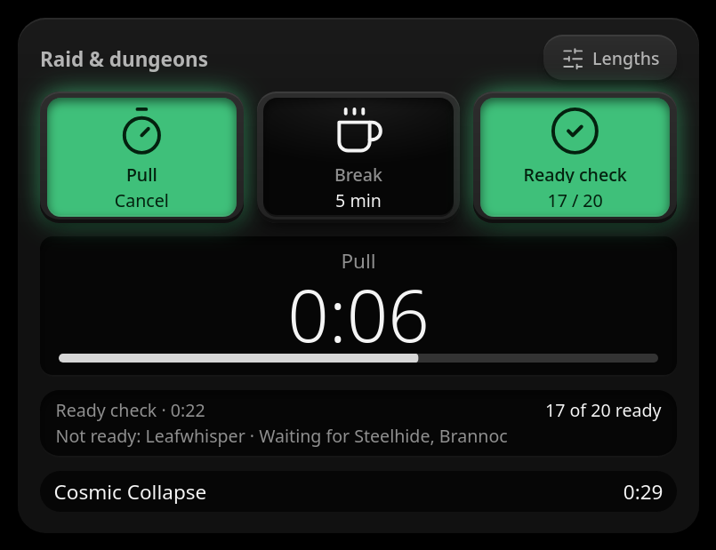 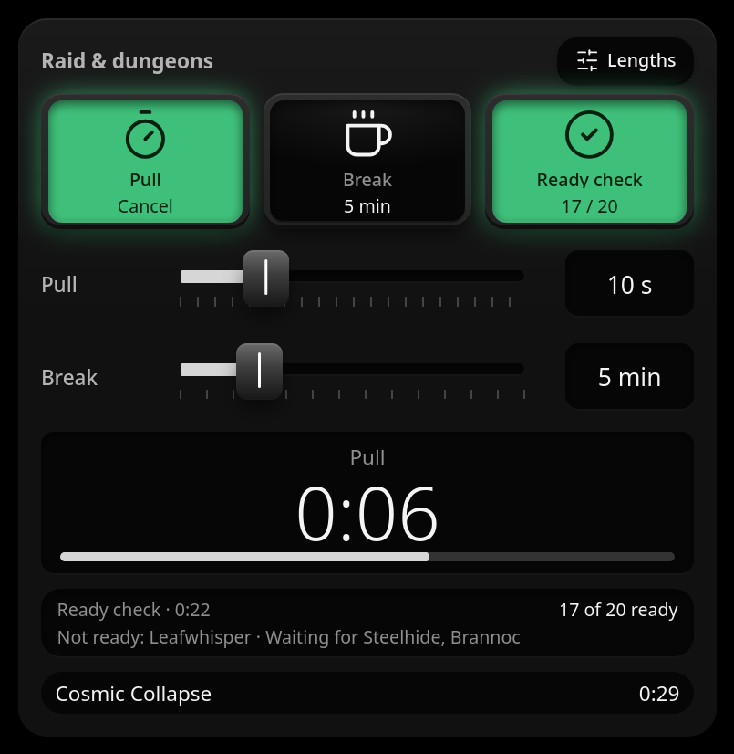

- **Pull** starts the group's pull countdown: Blizzard's own, which BigWigs and DBM show as their pull bar (with BigWigs it goes through its `/pull`, without opening chat). While one runs, the key reads **Cancel**.
- **Break** starts a break timer through BigWigs, DBM or NSRT, whichever you have.
- **Ready check** starts one; under the timer, how many are ready, who is not, and who has not answered.
- **Lengths** (top right) shows the pull and break faders; most people send the same every time, so they stay folded away. Each screen remembers its own lengths, starting from the defaults in settings.
- The big timer follows the game: anyone's pull or break bar, from any boss mod. Boss mod bars are listed below it. In a dungeon or raid the game hides a pull countdown's length from addons: a pull sent from the page still counts down, while someone else's reads **Pull started** with no figure.

### Mythic+

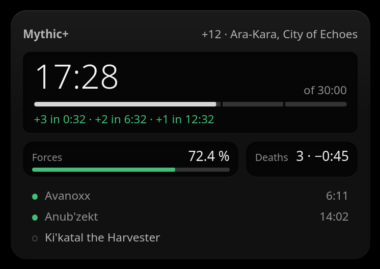

Your key as it runs: the time against the limit, the bar marked where +3 (60 % of the time) and +2 (80 %) run out, the best chest still in reach first, enemy forces, deaths and the time they cost, and each boss with when it fell. At the end, **Timed** with its chests or **Over time by …**. Outside a key it shows your keystone.

### World markers

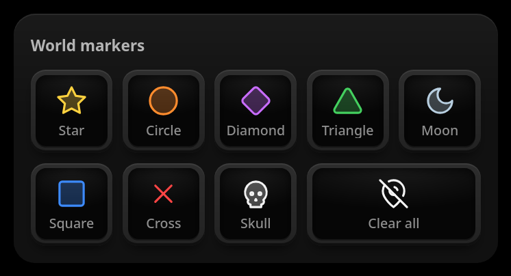

The eight markers in their colours, star first as players know them; each lands where your mouse points in game, as a key bound to it would place it. **Clear all** removes them. In a raid only the leader and assistants may place markers.

### Buff check

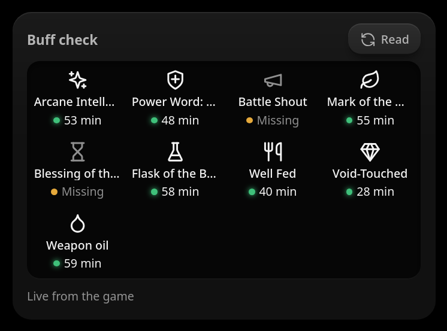 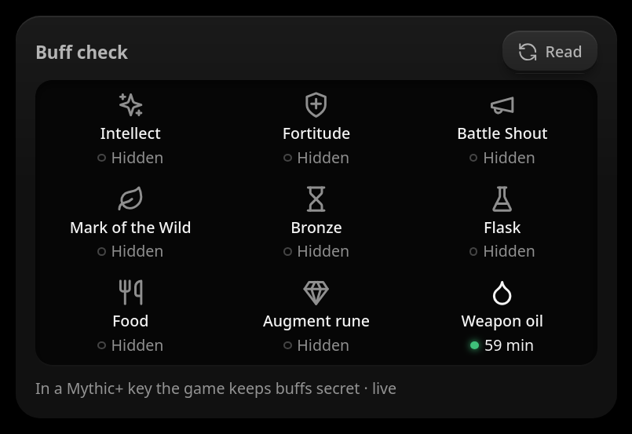

What you need before the pull, counting down: your food, flask, augment rune and weapon oil, and your own class's raid buff (with a key to cast it when it is missing). Another class's raid buff is asked for only when someone of that class is in your group. Each cell says what it checks (Flask, Augment rune); the buff the game found, such as your flask's name, is in its tooltip. In combat, during a boss fight and for a whole Mythic+ key the game hides buffs from addons: then a buff it cannot see reads **Hidden**, not missing (weapon oil still shows), so the check is for before the pull. In a raid between pulls it reads as usual. The addon asks the game whether buffs are hidden at that moment, so the check never guesses.

### NSRT note and its alerts

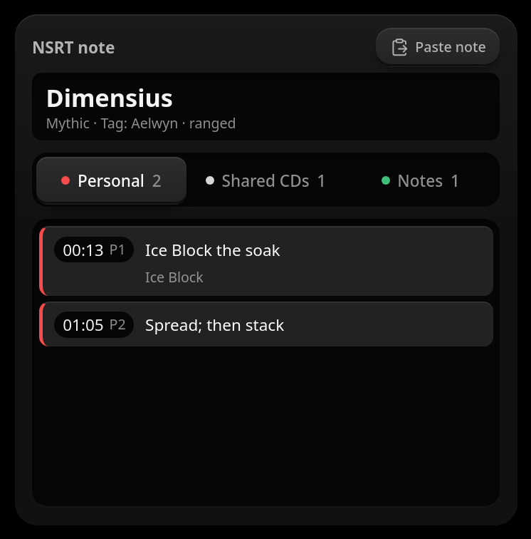 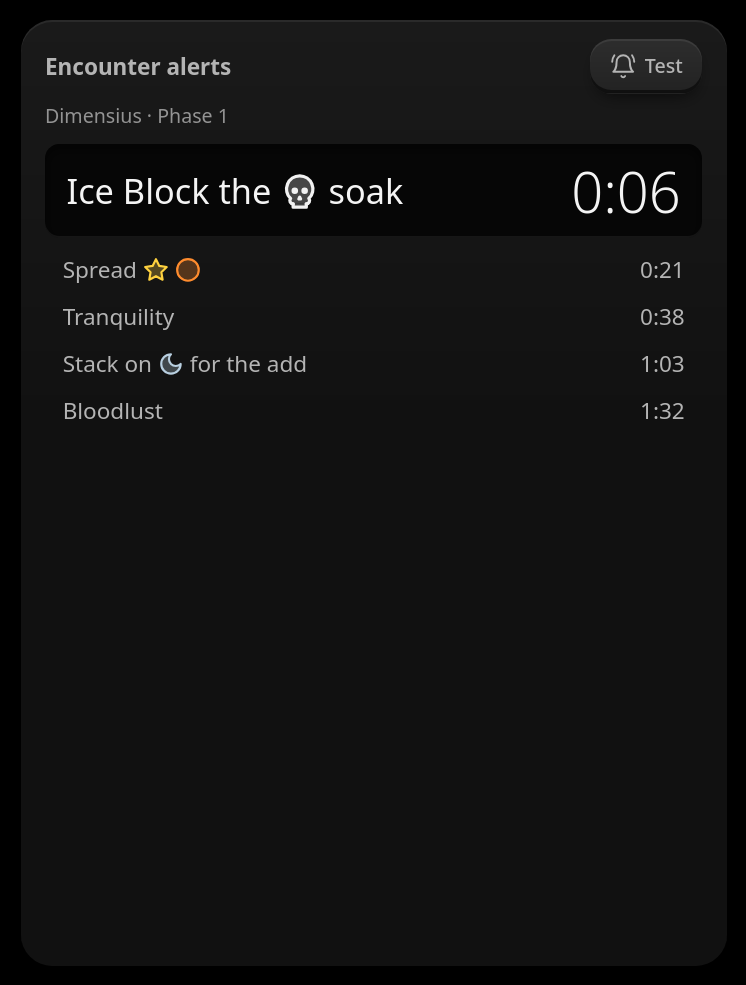

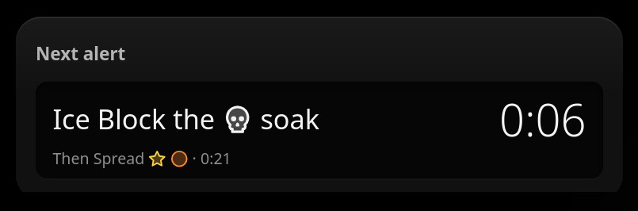 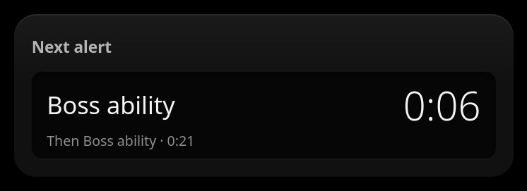

- **NSRT note**: your raid's Northern Sky Raid Tools note, your reminders first (tagged with your character or role), then the shared cooldowns and the notes. It comes from NSRT's saved data, or from the PC's clipboard with **Paste note**.
- **Encounter alerts**: NSRT's alerts for the phase that runs, as NSRT scheduled them, the next one large with its countdown and the rest below it. Raid marks show in their colours. **Test** runs NSRT's own test of phase 1.
- **Next alert** (a Raid & dungeons plate, so it works with NSRT off too): whatever comes first, your boss mod's next ability or NSRT's next alert, large with its countdown, and the one after it. In raids NSRT's reminders and BigWigs' or DBM's bars mix; in dungeons NSRT runs no reminders, so it is the boss mod's: BigWigs takes them from the game's own encounter timeline, and with LittleWigs installed most of them have their names. A bar whose name the game keeps secret (a boss no module knows) reads **Boss ability**, with its true countdown.

### Character

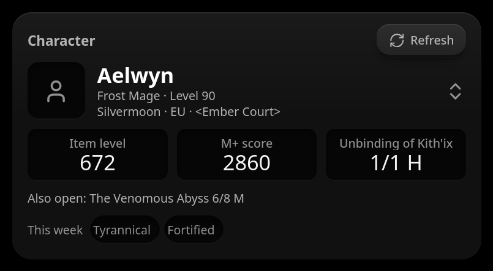

Your character from Raider.IO and Battle.net: item level, Mythic+ score, raid progress, this week's affixes. Its name switches between your characters.

### Gold, bags, keystones and characters

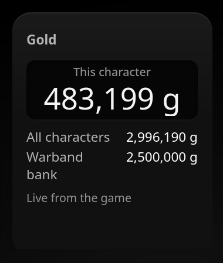 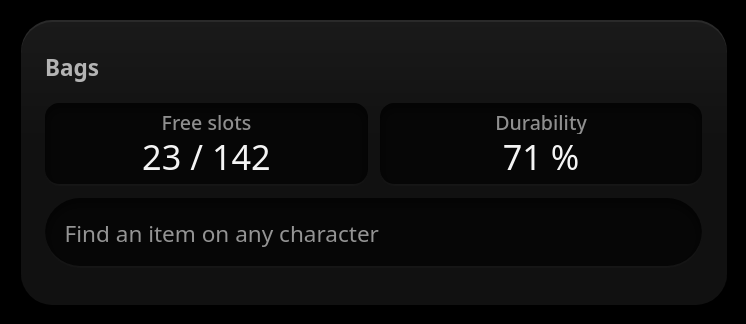

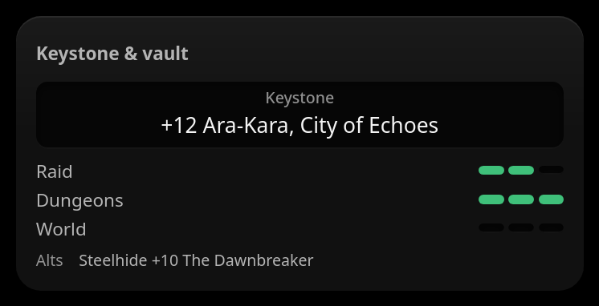 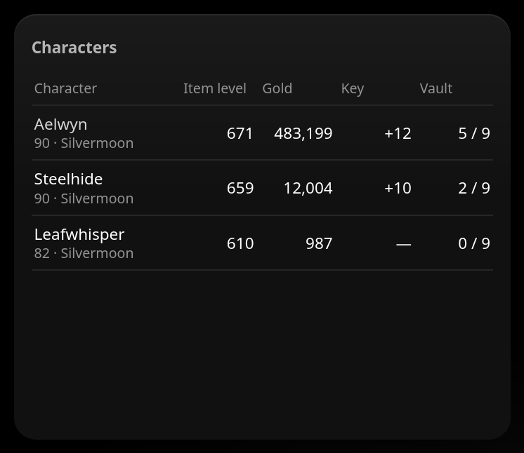

From the addon: gold on this character, on all of them and in the warband bank; free bag slots, durability, and a search through every character's bags (and banks, once opened); your keystone and this week's Great Vault; every character the addon has seen. Characters you are not playing are as of their last logout or `/reload`.

### WoW Token and the combat log

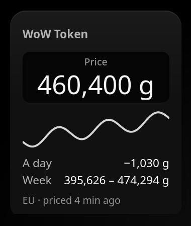 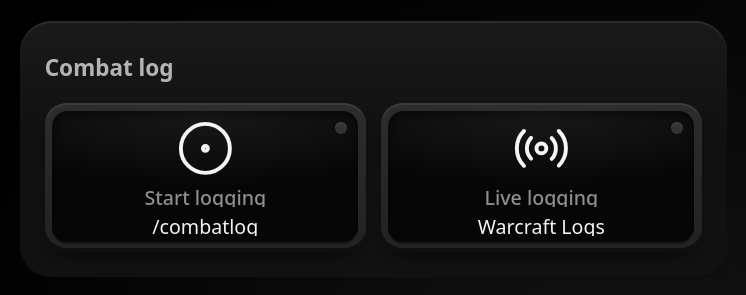

The WoW Token's price and its week (needs a Battle.net client key), and the combat log keys: start logging, and live logging with Warcraft Logs.

### Keys

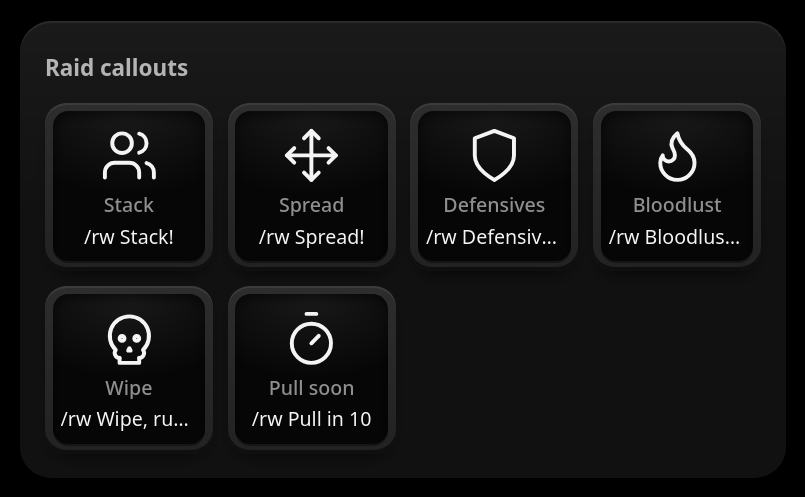

A plate of keys you choose, any command: the game's, an addon's (Details!, DBM, WeakAuras, MDT, Plater, ElvUI, SimulationCraft…) or your own. A new one starts empty or from a template, and you edit it from there.

---

## Arranging the page

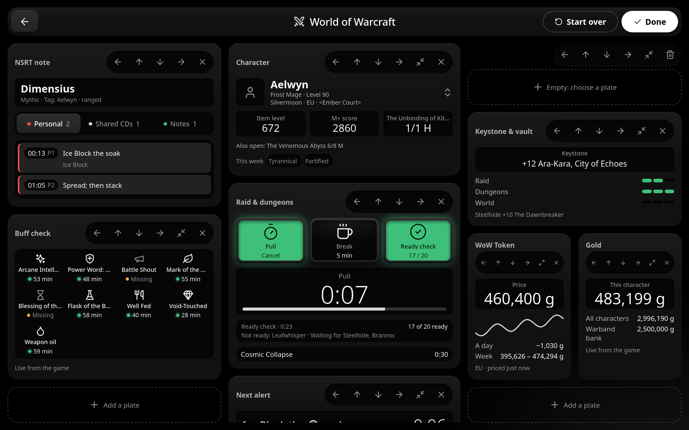

The pencil (top right) arranges the page, on any screen. Each plate gets a tray: move it left, up, down or right, make it half or full width, or remove it (its space stays while you arrange, to put another plate there). **Add a plate** at the bottom of each column. **Done** keeps it; **Start over** goes back to the first layout.

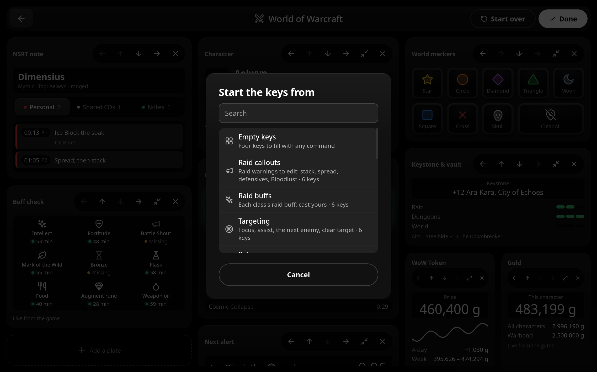

A new keys plate starts from **Empty keys** or a template: world markers, target marks, raid lead, dungeon, raid callouts, raid buffs, targeting, pet, character, interface, emotes, your addons' windows, NSRT, BigWigs bars, tools. Templates only offer keys for addons you have.

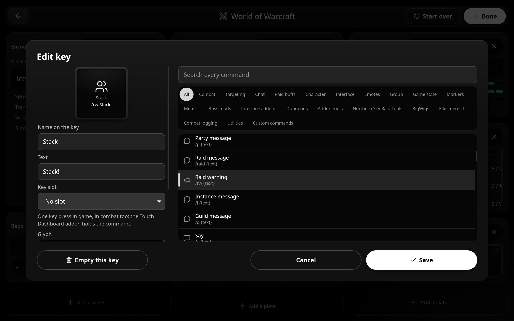

Hold a key, or tap one while arranging, to edit it: any command by category or search, its arguments (a marker, a length, a raid warning's text), its name and glyph, and on the PC its key slot or a command of your own.

---

## Settings

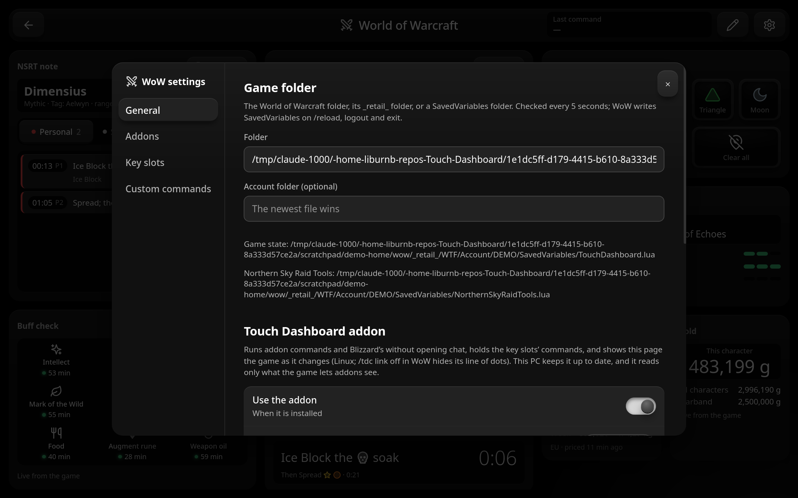

On the PC, the gear: **General** (the game folder, the addon and its status, your character and role tag), **Addons** (turn each part of the page on or off, and change an addon command's text), **Key slots**, and **Custom commands**. A tablet can arrange the page but not change what the keys type.

Themes apply here too:

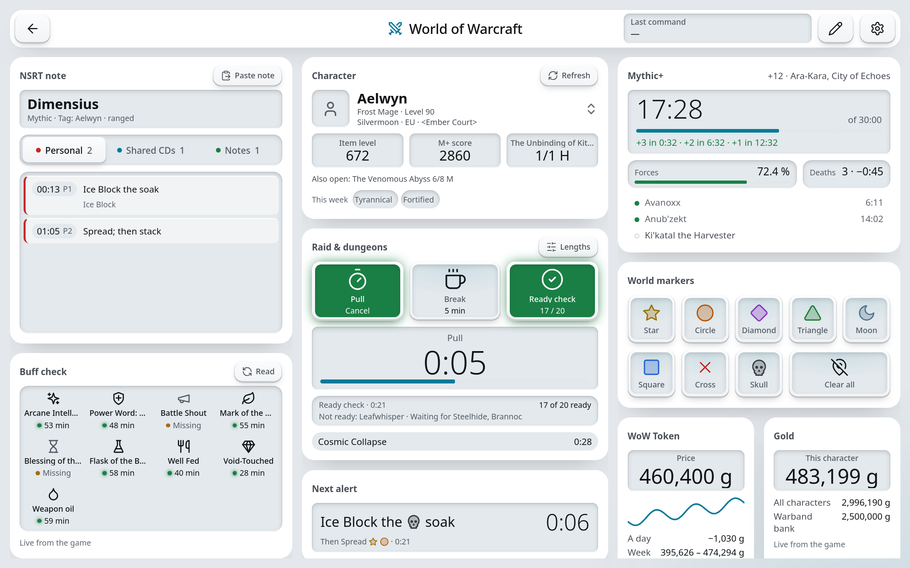

---

## What it cannot do

- **Nothing secret.** In combat, encounters and Mythic+ the game hides buffs and cooldowns from addons (Midnight's rules), so the buff check is for before the pull, and nothing the game hides reaches the page. In a dungeon or raid the game also hides the numbers of anyone's pull countdown and who started a ready check: the page shows that a pull started, not its length, and finds the ready check's asker from who the game already counts as ready.
- **No automation.** The PC presses a key only when you tap one; nothing is ever pressed because of what the page shows.
- **WoW in front.** Keys go to the window in front, so WoW must be it. The page checks, and presses nothing otherwise.
- **The live link is Linux-only** (WoW through Wine or Proton under X11 or XWayland). On Windows the page reads the game through the addon's box when a command runs, or with **Read**.
- **Not yet tried in a real raid:** NSRT's alerts during an encounter, the ready check's answers, and a pull countdown started by someone else.

---

## Making these pictures

```bash
.venv/bin/python scripts/wow_demo.py &                 # the page with fictional data on 127.0.0.1:8899
/usr/bin/python3 scripts/wow_docs_render.py            # every picture here, into docs/images/wow
```

`wow_demo.py` runs a server like the real one with its own temporary home: your config, game folder, keyboard and clipboard are never touched. `wow_docs_render.py` draws the page with WebKitGTK (the desktop window's engine, from the system's packages) at the tablet's size and density, one picture or plate at a time; name shots to render only those.
